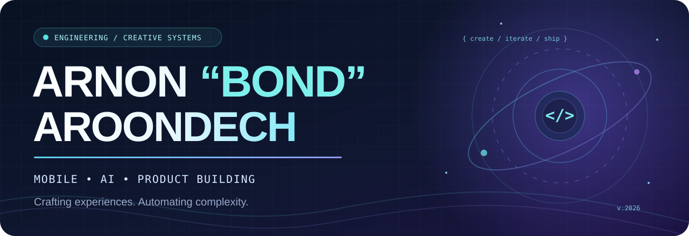

  

   

  
  
  

 

### Hey, I'm Bond 👋

I'm a **mobile engineer and product-minded builder** based in Bangkok, Thailand. My day-to-day world revolves around **Flutter, Android, clean architecture, and shipping reliable experiences**. I enjoy connecting engineering discipline with a curiosity for design, AI, and practical automation.

I work on mobile experiences at **Central Retail Digital**. Outside of that, I like building small products, exploring financial technology, and finding smarter ways for developers to work.

> I care about the little things: a smooth interaction, a tricky edge case, a reproducible bug, and that satisfying moment when everything finally clicks.

### ⚡ What I love building

<table>
  <tr>
    <td width="33%" valign="top"><b>📱 Mobile that feels right</b>  Flutter and native Android experiences, responsive UI, performance, stability, and thoughtful UX.</td>
    <td width="33%" valign="top"><b>🤖 Smarter engineering</b>  AI-assisted workflows, developer tools, automation, testing, and quality gates that earn trust.</td>
    <td width="34%" valign="top"><b>🧠 Useful little products</b>  Web apps, market-data experiments, and everyday tools that turn an idea into something people can use.</td>
  </tr>
</table>

### 🧰 My toolkit

**Mobile & UI**

**Web, data & automation**

### 🚀 Selected public projects

<table>
  <tr>
    <td width="50%" valign="top">
      <h3>📈 <a href="https://github.com/arnon-aroon/market-radar">Market Radar</a></h3>
      A Thai-time dashboard for US market and Bitcoin events, with a searchable calendar, notes, and offline-friendly PWA features.  
      <code>Market data</code> <code>PWA</code> <code>JavaScript</code>
    </td>
    <td width="50%" valign="top">
      <h3>🍱 <a href="https://github.com/arnon-aroon/lunch-picker">LunchDecisionStudio</a></h3>
      A mobile-first lunch picker that helps teams decide where to eat, with walking-distance preferences.  
      <code>Next.js</code> <code>TypeScript</code> <code>Prisma</code>
    </td>
  </tr>
  <tr>
    <td width="50%" valign="top">
      <h3>🪙 <a href="https://github.com/arnon-aroon/SemiCrypto">SemiCrypto</a></h3>
      An Android cryptocurrency explorer built around modular MVVM, Jetpack Compose, and paginated data.  
      <code>Kotlin</code> <code>Jetpack Compose</code> <code>Android</code>
    </td>
    <td width="50%" valign="top">
      <h3>💼 <a href="https://github.com/arnon-aroon/flutter-my-portfolio">Flutter Portfolio</a></h3>
      A personal portfolio experiment built with Flutter — bringing mobile UI ideas to the web.  
      <code>Flutter</code> <code>Dart</code> <code>Web</code>
    </td>
  </tr>
</table>

  <a href="https://github.com/arnon-aroon?tab=repositories"><b>See more of my public work →</b></a>

### 🌌 Currently curious about

<code>AI agents &amp; developer workflows</code> · <code>Mobile QA &amp; automation</code> · <code>Fintech &amp; market intelligence</code> · <code>Developer experience</code> · <code>Creative product design</code>

### 📊 GitHub activity

  
  

Language percentages describe public repository code, not proficiency. Third-party stat cards may occasionally be unavailable.

 
 

  

